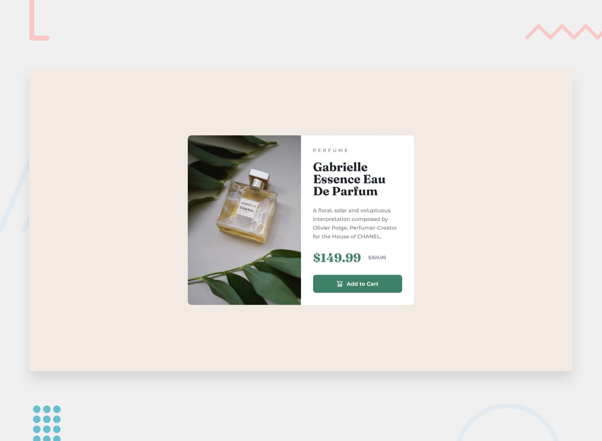

# Product Preview Card Component

Este projeto foi desenvolvido como parte de um desafio do [Frontend Mentor](https://www.frontendmentor.io/), com o objetivo de reproduzir um componente de apresentação de produto, utilizando HTML e CSS.

## 📸 Preview

## 🚀 Tecnologias utilizadas

- HTML5
- CSS3 FlexBox
- CSS Variables (variáveis personalizadas)
- Media Queries
- Google Fonts

## 💻 Funcionalidades

- Layout responsivo para dispositivos desktop e mobile.
- Imagens adaptadas para diferentes tamanhos de tela utilizando a tag `<picture>`.
- Apresentação de informações do produto, incluindo descrição e preços.
- Botão de compra com efeito de interação (*hover*).
- Organização visual utilizando Flexbox.

## 🔗 Links

- **Frontend Mentor:** [Desafio original](https://www.frontendmentor.io/challenges/product-preview-card-component-GO7UmttRfa)
- **Repositório:** [GitHub](https://github.com/Dev-jaoo/Product-Preview-Card-Component)

## 👨‍💻 Autor

Desenvolvido por [João](https://github.com/Dev-jaoo).